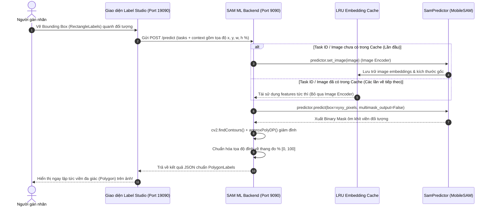

# Label Studio ML Backend: Tích hợp SAM / MobileSAM với Box Prompt (Interactive Segmentation)

Tài liệu hướng dẫn triển khai và tích hợp mô hình **Segment Anything Model (MobileSAM)** vào **Label Studio** thông qua cơ chế gợi ý tương tác bằng **Bounding Box (Box Prompt)**.

---

## 1. Kiến trúc & Cơ chế hoạt động (System Architecture)



---

## 2. Cấu trúc thư mục

```text
Labeling/
├── labeling/
│   └── sam_backend/
│       ├── _sam_backend.py        # Code chính xử lý ML Backend, LRU Cache, SAM Predictor
│       ├── _wsgi.py               # WSGI entrypoint tương thích label-studio-ml CLI
│       ├── label_config.xml       # Cấu hình giao diện nhãn XML cho Label Studio
│       ├── requirements.txt       # Danh sách thư viện phụ thuộc
│       ├── weights/
│       │   └── mobile_sam.pt      # Trọng số MobileSAM (39 MB, tự động tải nếu thiếu)
│       └── README.md              # Hướng dẫn chi tiết
├── _sam_backend.py                # Wrapper chuyển tiếp ở thư mục gốc
├── test_backend.py                # Script kiểm thử tự động offline
├── start_sam_backend.bat          # Script khởi động 1-click cho Windows
└── start_sam_backend.sh           # Script khởi động cho Linux/macOS
```

---

## 3. Cài đặt môi trường (Installation)

Yêu cầu Python >= 3.9 (đã được kiểm thử trên cả CPU và GPU CUDA).

```bash
# Cài đặt các thư viện cần thiết
pip install -r labeling/sam_backend/requirements.txt
```

Hoặc cài trực tiếp:
```bash
pip install label-studio-ml torch torchvision opencv-python timm requests
pip install git+https://github.com/ChaoningZhang/MobileSAM.git
```

---

## 4. Kiểm thử Backend offline (Verification)

Chạy file script test có sẵn để xác nhận mô hình tải trọng số, chạy suy luận và kiểm tra tính hiệu quả của LRU Cache:

```bash
python test_backend.py
```

**Kết quả kiểm thử thực tế trên CPU cục bộ:**
* **Lần 1 (Cache Miss - trích xuất Image Encoder):** ~2.2s (tạo 37 đỉnh đa giác, độ chính xác score = 0.9981).
* **Lần 2 (Cache Hit - tái sử dụng đặc trưng ảnh):** ~172ms (**tăng tốc gấp 13.2x**).

---

## 5. Khởi chạy ML Backend Server

### Cách 1: Chạy trực tiếp qua script (Khuyến nghị trên Windows)
```bash
# Windows
start_sam_backend.bat

# Hoặc bằng Python trực tiếp:
python labeling/sam_backend/_sam_backend.py --port 9090
```

### Cách 2: Chạy qua lệnh `label-studio-ml`
```bash
label-studio-ml start labeling/sam_backend --port 9090
```

Khi server khởi động thành công, bạn sẽ thấy thông báo:
```text
[SERVER READY] ML Backend đang chạy tại http://localhost:9090
```

---

## 6. Cấu hình Project trên Label Studio

### Bước 1: Cấu hình giao diện nhãn (Labeling Interface)
1. Mở Label Studio trên trình duyệt (`http://localhost:19090`).
2. Vào Project của bạn -> chọn **Settings** -> **Labeling Interface** -> **Code View**.
3. Dán toàn bộ nội dung từ file [label_config.xml](file:///C:/Users/win10/Desktop/Labeling/labeling/sam_backend/label_config.xml):

```xml
<View>
  <!-- Vùng hiển thị ảnh -->
  <Image name="image" value="$image" zoom="true" zoomBy="1.5" rotateControl="true"/>

  <!-- 1. Bounding Box Prompt dùng để khoanh vùng đối tượng cho SAM -->
  <Header value="1. Chọn nhãn và vẽ Bounding Box bao quanh đối tượng (Box Prompt)" size="5" style="margin-top: 10px; color: #2c3e50; font-weight: bold;"/>
  <RectangleLabels name="bbox" toName="image" canRotate="false">
    <Label value="Plant" background="#27ae60"/>
    <Label value="Leaf" background="#2ecc71"/>
    <Label value="Fruit" background="#e67e22"/>
    <Label value="Disease" background="#e74c3c"/>
    <Label value="Stem" background="#8e44ad"/>
    <Label value="Car" background="#3498db"/>
    <Label value="Person" background="#e91e63"/>
    <Label value="Object" background="#95a5a6"/>
  </RectangleLabels>

  <!-- 2. Polygon sinh tự động từ SAM -->
  <Header value="2. Viền đa giác (Polygon) sinh tự động từ SAM ML Backend" size="5" style="margin-top: 10px; color: #2c3e50; font-weight: bold;"/>
  <PolygonLabels name="polygon" toName="image" strokeWidth="2" opacity="0.6" pointSize="small">
    <Label value="Plant" background="#27ae60"/>
    <Label value="Leaf" background="#2ecc71"/>
    <Label value="Fruit" background="#e67e22"/>
    <Label value="Disease" background="#e74c3c"/>
    <Label value="Stem" background="#8e44ad"/>
    <Label value="Car" background="#3498db"/>
    <Label value="Person" background="#e91e63"/>
    <Label value="Object" background="#95a5a6"/>
  </PolygonLabels>
</View>
```
4. Bấm **Save**.

---

### Bước 2: Kết nối ML Backend vào Project
1. Vào **Settings** -> **Machine Learning** -> bấm nút **Add Model**.
2. Điền các thông tin:
   * **Title**: `MobileSAM Interactive Backend`
   * **URL**: `http://localhost:9090` (hoặc `http://127.0.0.1:9090`)
   * **Interactive preannotations**: BẬT công tắc này (**Auto-Annotation**).
3. Bấm **Validate and Save**.
4. Trạng thái hiển thị badge xanh lá cây `Connected` là thành công!

---

## 7. Quy trình gán nhãn thực tế trên giao diện

1. Mở một Task bất kỳ trong Project.
2. Bật công tắc **Auto-Annotation** ở góc phải màn hình gán nhãn.
3. Chọn một nhãn từ nhóm **1. Bounding Box Prompt** (ví dụ: `Plant`, `Car`...).
4. Dùng chuột kéo một khung chữ nhật bao quanh đối tượng cần phân đoạn.
5. Ngay khi thả chuột:
   * Box prompt được gửi đến ML Backend.
   * SAM suy luận mặt nạ và tự động chuyển đổi thành đa giác **PolygonLabels**.
   * Đường viền đa giác ôm sát từng chi tiết của đối tượng xuất hiện ngay lập tức trên ảnh.
6. Người gán nhãn có thể kéo chỉnh sửa các điểm đỉnh của Polygon nếu muốn tinh chỉnh thêm trước khi bấm **Submit**.

---

## 8. Tinh chỉnh nâng cao (Fine-tuning Hyperparameters)

Các biến môi trường có thể cấu hình linh hoạt:

| Tên biến môi trường | Mặc định | Ý nghĩa |
|---|---|---|
| `APPROX_EPSILON` | `0.002` | Hệ số xấp xỉ Douglas-Peucker. Giá trị càng lớn số điểm đỉnh càng ít (tối ưu web mượt hơn), giá trị nhỏ hơn giúp viền cong mịn hơn. |
| `MIN_CONTOUR_AREA` | `20.0` | Loại bỏ các đốm mask nhỏ hoặc nhiễu có diện tích nhỏ hơn ngưỡng này (pixel). |
| `MODEL_TYPE` | `vit_t` | Kiến trúc mô hình (`vit_t` cho MobileSAM, `vit_b`, `vit_l`, `vit_h` cho SAM nguyên bản). |
| `CHECKPOINT_PATH` | `weights/mobile_sam.pt` | Đường dẫn tệp trọng số tùy chỉnh. |
