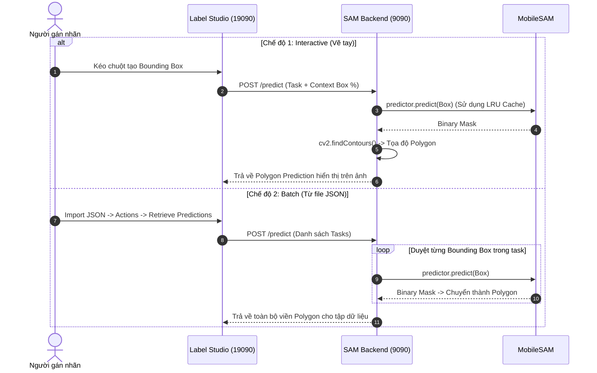

# Label Studio ML Backend – MobileSAM

**Interactive Segmentation · Batch Auto-Segment · Dynamic Labels · Auto-Provisioning**

ML Backend tích hợp **MobileSAM** vào **Label Studio**, hỗ trợ tự động bọc viền đa giác (Polygon Segmentation) từ Bounding Box cho cả gán nhãn tương tác trực tiếp và xử lý hàng loạt file JSON.

---

## 1. Tính năng nổi bật

1. **Interactive Segmentation (Box Prompt):** Kéo Bounding Box quanh đối tượng trên ảnh -> MobileSAM tự động suy luận Binary Mask và chuyển đổi thành viền đa giác Polygon ôm sát đối tượng.
2. **Batch Auto-Segment từ JSON:** Đọc danh sách Bounding Box từ dữ liệu JSON import vào Label Studio và tự động tạo Polygon hàng loạt qua lệnh _Retrieve Predictions_ (hoặc xử lý trước qua `auto_segment_yolo.bat`).
3. **Auto-Provisioning:** Tự động nạp cấu hình giao diện `label_config.xml`, kết nối ML Backend cổng 9090 và gán Webhook vào dự án mới qua Label Studio API.
4. **Dynamic Labels:** Tiếp nhận tên nhãn mới linh hoạt thông qua ô nhập text và tự động đồng bộ vào danh sách nhãn.
5. **LRU Embedding Cache:** Lưu trữ Image Embedding tạm thời trên RAM, giúp các thao tác vẽ box tiếp theo trên cùng một ảnh phản hồi tức thì (< 30ms).

---

## 2. Kiến trúc hoạt động



---

## 3. Cấu trúc thư mục

```text
labeling/
├── converters/
│   ├── auto_segment_yolo.bat   # Bọc viền SAM hàng loạt offline từ thư mục YOLO
│   ├── convert_yolo.bat        # Chuyển đổi YOLO sang JSON Label Studio chuẩn
│   ├── yolo_converter.py       # Module xử lý tọa độ & mã hóa URL Local Storage
│   └── yolo_to_sam_polygons.py # Engine MobileSAM chạy lô offline
├── data/                       # Database SQLite, ảnh upload và dữ liệu export
├── sam_backend/
│   ├── _sam_backend.py         # Backend chính (MobileSAM, Batch Inference, Cache, Webhook)
│   ├── _wsgi.py                # WSGI entrypoint chuẩn Label Studio ML
│   ├── label_config.xml        # Bản thiết kế giao diện XML chuẩn (Smart Box + Polygon)
│   ├── requirements.txt        # Danh sách thư viện phụ thuộc (Web + Backend AI)
│   ├── start_sam_backend.bat   # Script chạy 1-Click trên Windows
│   ├── start_sam_backend.sh    # Script chạy trên Linux/macOS
│   ├── test_backend.py         # Script kiểm thử offline & đo hiệu năng Cache
│   ├── token.txt               # Access Token kết nối Label Studio API (cục bộ)
│   └── weights/
│       └── mobile_sam.pt       # Trọng số MobileSAM (39 MB, tự động tải nếu thiếu)
└── start_labelstudio.bat       # Script khởi chạy Label Studio mở khóa đọc file cục bộ
```

> **Lưu ý bảo mật:** Không commit file `token.txt` lên GitHub. File này đã được đưa vào `.gitignore`.

---

## 4. Yêu cầu hệ thống

- **Python:** >= 3.9 (kiểm thử trên cả CPU và GPU CUDA).
- **Git:** Bắt buộc cài trên máy để cài đặt gói MobileSAM từ GitHub.
- **Hệ điều hành:** Hỗ trợ đầy đủ Windows, Ubuntu/Linux và macOS.

---

## 5. Cài đặt môi trường

Mở Terminal tại thư mục gốc dự án (`labeling_tool`):

```bash
# 1. Tạo và kích hoạt môi trường ảo (Khuyến nghị)
python -m venv .venv

# Trên Windows:
.venv\Scripts\activate

# Trên Linux/macOS:
source .venv/bin/activate

# 2. Cài đặt toàn bộ thư viện (gồm cả Label Studio và SAM Backend)
pip install -r labeling/sam_backend/requirements.txt
```

---

## 6. Khởi động hệ thống

Hệ thống yêu cầu chạy **2 Terminal song song**:

### Terminal 1: Khởi động SAM ML Backend (Port 9090)

Mở Terminal tại thư mục gốc `labeling_tool`:

**Trên Windows:**

```bat
python labeling/sam_backend/_sam_backend.py --port 9090
```

_(Hoặc nhấp đúp file `labeling\sam_backend\start_sam_backend.bat`)_

**Trên Linux / macOS:**

```bash
chmod +x labeling/sam_backend/start_sam_backend.sh
./labeling/sam_backend/start_sam_backend.sh
```

Khi khởi động thành công:

```text
[MODEL] Khởi tạo MobileSAM thành công!
[SERVER READY] MobileSAM (Interactive + Auto-Batch Import) đang chạy tại http://localhost:9090
```

### Terminal 2: Khởi động Label Studio Web (Port 19090)

Mở Terminal thứ 2 độc lập tại thư mục gốc `labeling_tool`:

**Trên Windows:**

```bat
set LABEL_STUDIO_DISABLE_SSRF_PROTECTION=true
set USE_DEFAULT_BANNED_SUBNETS=false
set ML_BLOCK_LOCAL_IP=false
set LABEL_STUDIO_LOCAL_FILES_SERVING_ENABLED=true
set LABEL_STUDIO_LOCAL_FILES_DOCUMENT_ROOT=%SystemDrive%\
cd labeling
label-studio start --port 19090 --data-dir ./data
```

_(Khuyên dùng: Nhấp đúp chạy trực tiếp file `labeling/start_labelstudio.bat`)_

**Trên Linux / macOS:**

```bash
export LABEL_STUDIO_DISABLE_SSRF_PROTECTION=true
export USE_DEFAULT_BANNED_SUBNETS=false
export ML_BLOCK_LOCAL_IP=false
export LABEL_STUDIO_LOCAL_FILES_SERVING_ENABLED=true
export LABEL_STUDIO_LOCAL_FILES_DOCUMENT_ROOT=/
cd labeling
label-studio start --port 19090 --data-dir ./data
```

Đăng nhập hệ thống qua trình duyệt: http://localhost:19090

---

## 7. Cấu hình Access Token (Dành cho Auto-Provisioning)

Để backend tự động nạp cấu hình giao diện XML và kết nối mô hình cổng 9090 vào mọi dự án mới:

1. Đăng nhập vào web Label Studio (`http://localhost:19090`).
2. Bấm vào **Avatar** ở góc trên cùng bên phải -> chọn **Account & Settings**.
3. Sao chép chuỗi tại mục **Access Token**.
4. Tạo file văn bản `token.txt` tại vị trí:
   ```text
   labeling/sam_backend/token.txt
   ```
5. Dán chuỗi token vừa copy vào file và lưu lại.

---

## 8. Hướng dẫn sử dụng

### 8.1. Gán nhãn tương tác (Interactive Segmentation)

1. Mở một ảnh bất kỳ trong dự án.
2. Bật công tắc **Auto-Annotation** ở thanh công cụ phía dưới ảnh.
3. Chọn nhãn cần gán, dùng chuột kéo một **Bounding Box** (phím `R`) bao quanh đối tượng.
4. MobileSAM sẽ tự động tính toán (< 30ms) và bọc viền đa giác **Polygon** ôm khít đối tượng.

### 8.2. Xử lý hàng loạt từ file JSON (Batch Auto-Segment)

1. Tại giao diện dự án, bấm **Import** và tải lên file JSON có sẵn Bounding Box.
2. Vào **Data Manager**, tích chọn các task cần xử lý.
3. Chọn menu **Actions** -> bấm **Retrieve Predictions**.
4. Backend sẽ tự động duyệt toàn bộ Bounding Box và chuyển đổi thành viền **Polygon** tương ứng.

---

## 9. Cấu hình thủ công (Dự phòng nếu không dùng Auto-Provision)

Nếu muốn tự thiết lập cho một dự án riêng biệt:

1. **Giao diện nhãn:** Vào **Settings** -> **Labeling Interface** -> chọn **Code View** -> dán toàn bộ nội dung từ file `labeling/sam_backend/label_config.xml` -> bấm **Save**.
2. **Kết nối Backend:** Vào **Settings** -> **Machine Learning** -> bấm **Add Model**:
   - **URL:** `http://localhost:9090`
   - **Interactive preannotations:** Bật công tắc
   - Bấm **Validate and Save** (Trạng thái chuyển sang badge xanh `Connected` là thành công).

---

## 10. Tinh chỉnh thuật toán & Tối ưu hóa (Advanced Tuning)

Trong file `_sam_backend.py`, bạn có thể tùy chỉnh các hằng số:

- `SIMPLIFY_EPSILON` (Mặc định `0.002`): Hệ số làm mượt viền Polygon (Ramer-Douglas-Peucker). Tăng lên nếu muốn giảm bớt số đỉnh polygon, giảm xuống nếu muốn viền chi tiết cực đại.
- `MAX_CACHE_SIZE` (Mặc định `16`): Số lượng embedding ảnh lưu trong LRU Cache. Đảm bảo tốc độ vẽ tức thì trên máy ít RAM.
